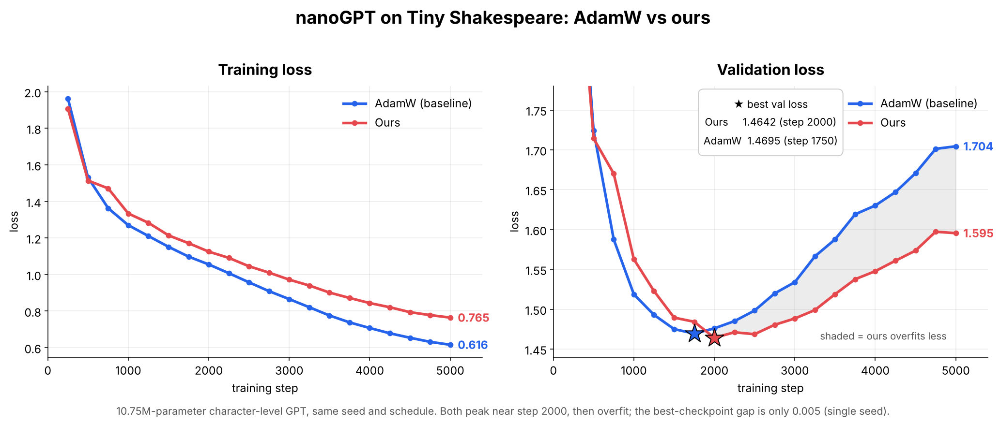
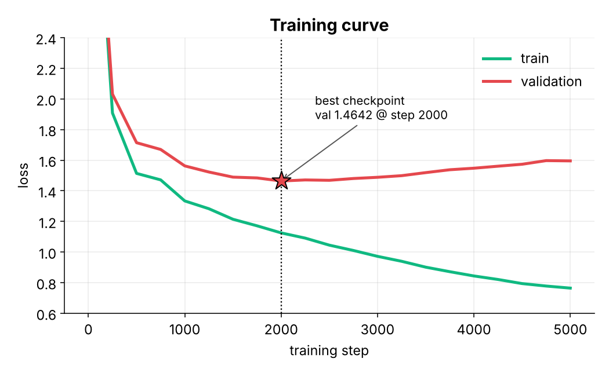

<div align="center">

# 🎭 Shakespeare GPT

**A tiny 10.75M-parameter language model that writes like the Bard, one character at a time.**

Runs **entirely on your device** — in the browser or in Python. No server, no API keys, no uploads.

🌐 **[Try it in your browser](https://hariomlohardev.github.io/shakespeare-gpt/)** · 💻 runs offline · 🐍 plain PyTorch

</div>

---

## ✨ Highlights

- A from-scratch **decoder-only transformer** in plain PyTorch (6 layers · 6 heads · 384-dim · 256-character context).
- Trained on **Tiny Shakespeare** (~1 MB of text).
- A **browser demo** that runs 100% locally — open the GitHub Pages link above and type a prompt.
- A one-liner to **generate from Python** on your CPU.
- Full training script included, with loss curves and an honest AdamW comparison.
- Trained with a **custom optimizer**. 🤫 *Details coming soon. Surprise!*

## 📊 Results



| | **Ours** | AdamW (baseline) |
|---|---:|---:|
| Best validation loss | **1.4642** (step 2000) | 1.4695 (step 1750) |
| Validation loss at step 5000 | **1.5955** | 1.7045 |
| Training loss at step 5000 | 0.7646 | 0.6159 |

**How to read this honestly:** at the best checkpoint the two are essentially tied (a 0.005 gap on a single seed is within
run-to-run noise). The visible difference is *later*: past step ~2000 both start to overfit the ~1 MB corpus, and ours
degrades noticeably more slowly. We keep the best-validation checkpoint, so the published model is the step-2000 one.



## 📜 What it writes

Sampled from the released checkpoint (`temperature 0.8`):

<!--SAMPLE-->
```text
ROMEO:
I pray them to pity; they say you were there
To see it more than in so much: if you are all
The best that short we will make her to me
And see to see the foul of their own sighs of
Against the block of the king? Is this old of mine
To chide upon your request, with your children,
In this thing bear, I may must be rest
```
<!--/SAMPLE-->

It has learned the *shape* of a play (speaker names, line breaks, verse rhythm, archaic vocabulary), but not meaning.
Expect charming nonsense.

## 🌐 Try it in your browser (no install)

**Option 1 — GitHub Pages (easiest to share).**
This repo is Pages-ready: `docs/index.html` + `docs/model.bin`.

1. Push to GitHub.
2. Go to **Settings → Pages → Build and deployment → Deploy from a branch**,
   choose your branch and the **`/docs`** folder, then Save.
3. Open `https://hariomlohardev.github.io/shakespeare-gpt/`, type a prompt, press **Generate**.

Everything runs in the page — the weights are fetched once from your own repo, then generation happens on-device.

**Option 2 — locally, no server.**
Double-click `shakespeare_gpt_offline.html` (self-contained build made with `make_web_html.py`).
If you don't have that file yet, build it:

```bash
pip install torch numpy
python make_web_html.py   # writes shakespeare_gpt_offline.html (~55 MB, git-ignored)
```

**Option 3 — locally, from `docs/`.**
Browsers block `fetch()` on `file://` URLs, so serve the folder first:

```bash
cd docs
py -m http.server 8000
# open http://localhost:8000
```

If you opened `docs/index.html` directly and it says it couldn't auto-load `model.bin`,
use the file picker on the page and choose `docs/model.bin` by hand.

You can rebuild the browser weights any time:

```bash
python make_web_html.py --bin-only          # writes model.bin next to the script
copy model.bin docs\model.bin               # Windows
# cp model.bin docs/model.bin               # macOS / Linux
```

## 🚀 Quick start (Python, CPU)

```bash
pip install -r requirements.txt

# generate text from the checkpoint
python run_local.py "ROMEO:" 300 0.8
```

```python
import sys; sys.path.insert(0, "src")
from inference import Generator

g = Generator("model/best_ckpt.pt")
print(g.generate("JULIET:", max_new_tokens=300, temperature=0.8))
```

## 🏋️ Train it yourself

```bash
python src/train.py              # full run (~15 min on a T4, longer on CPU)
FAST=1 python src/train.py       # 400-step smoke test
python scripts/make_plots.py     # re-draw the figures from assets/*.csv
```

`src/train.py` runs with the standard **AdamW** baseline out of the box.

> ✨ **About our optimizer:** the released weights were trained with a custom optimizer that we are not publishing yet.
> *A surprise is coming soon. Stay tuned!* 🎭

## 🗂️ Repository layout

```
├── docs/             GitHub Pages site: index.html (browser demo) + model.bin (weights)
├── src/              model.py · inference.py · train.py
├── model/            best_ckpt.pt · config.json · vocab.json · MODEL_CARD.md
├── assets/           figures, loss histories, samples
├── scripts/          make_plots.py
├── shakespeare_template.html   source for the browser demo
├── make_web_html.py  packs the checkpoint into model.bin / a single-file HTML page
├── run_local.py      generate from the checkpoint on CPU
└── input.txt         Tiny Shakespeare training text
```

Large builds (`shakespeare_gpt_offline.html`, root `model.bin`, zips) are git-ignored —
they're easy to rebuild with `make_web_html.py`. The two weight files that *are*
committed on purpose are `model/best_ckpt.pt` (Python) and `docs/model.bin` (browser).

## ⚠️ Notes & limitations

- Character-level model on ~1 MB of text: it overfits quickly, so only the best-validation checkpoint is kept.
- The comparison above is a **single seed**; treat differences below ~0.01 in loss as noise.
- English only. Characters outside the 65-symbol vocabulary are ignored in prompts.
- The checkpoint contains **weights only** (no optimizer state, no training code).
